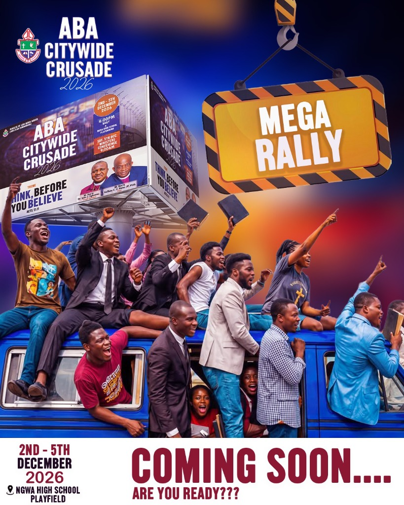

# ABA CITYWIDE CRUSADE 2026 — Minimal, Image-Driven Event Landing Page



A minimal, image-first, modern event campaign landing page designed and built for the **ABA CITYWIDE CRUSADE 2026**, organized by the **Diocese of Aba Ngwa North (Anglican Communion)**.

---

## 📸 Design Philosophy: 85–90% Visuals, 10–15% Text

The website is crafted as a premium event campaign website rather than a conventional text-heavy church site. It tells the story of the crusade primarily through breathtaking, high-quality event photography, horizontal carousels, and minimal text overlays.

### Key Characteristics:
- **Full-Width Photographic Sections:** Dramatic, high-contrast imagery capturing massive worship crowds, ministers preaching, believers in prayer, and youth campaign mobilization.
- **Dual Horizontal Image Carousels:**
  - *Worship & Crusade Experience Carousel:* Massive crowds, hands raised in praise, preaching, and fervent prayer.
  - *Citywide Revival in Motion Carousel:* Mega rally bus mobilization, sunglasses reflection artwork, ministers conference auditorium, and open scriptures.
  - Features smooth automatic looping, manual prev/next navigation buttons, mobile touch/swipe support, and pause-on-hover interaction.
- **Unboxed, Minimal Layout:** Zero rounded cards or container boxes cluttering the text. Content flows naturally with generous spacing and large, elegant typography.
- **Official Flyer Colour Palette:** Deep midnight navy (`#060d1f`), royal blue (`#1e3a8a`), warm sunset orange (`#ea580c`), and crisp white/slate.
- **Typography:** `Roboto` applied throughout in expressive, high-contrast weights.
- **Scroll Reveal Transitions:** Lightweight Intersection Observer animations where sections smoothly emerge with subtle upward translation and fade-in effects.

---

## 📅 Official Event Information

| Detail | Information |
| :--- | :--- |
| **Event Name** | **ABA CITYWIDE CRUSADE 2026** |
| **Organizing Ministry** | **Diocese of Aba Ngwa North (Anglican Communion)** |
| **Theme** | **THINK BEFORE YOU BELIEVE** |
| **Scripture Reference** | **Acts 17:11** |
| **Event Dates** | **2nd to 5th December 2026** |
| **Daily Crusade Time** | **4:00 PM Daily (WAT)** |
| **Crusade Venue** | **Ngwa High School Playground, Aba, Abia State** |
| **Guest Speaker** | **The Rt. Rev. Dr. Iyke J. Egbuonu** *(Bishop, Diocese of Oji River)* |
| **Host** | **The Rt. Rev. Nathan C. O. Kanu JP, Ph.D.** *(Bishop, Diocese of Aba Ngwa North)* |
| **Special Programme** | **Ministers Conference** |
| **Ministers Conf. Date** | **Saturday, 5th December 2026** |
| **Ministers Conf. Time** | **9:00 AM (WAT)** |
| **Official Registration** | [EventRally Registration Portal](https://www.geteventrally.com/events/bc7509fd-31fb-4ec1-881a-7e07f1a7ad8b) |

---

## 🏛️ Page Structure

1. **Simple Navigation Bar (`Navbar.tsx`):**
   - Left: Official Diocese crest logo.
   - Right: Minimal links (`Home`, `About`, `Event Details`), and a prominent `REGISTER NOW` CTA button.
2. **Section 1: Hero (`Hero.tsx`):**
   - Full-screen opening with massive congregation praise background (`/assets/congregation-praise.jpg`).
   - Official theme *"THINK BEFORE YOU BELIEVE"* (Acts 17:11), event name, date, and `REGISTER NOW` button.
3. **Section 2: About the Crusade (`About.tsx`):**
   - Full-width background (`/assets/crusade-stage.jpg`) with short headline *"ONE CITY. ONE GATHERING. ONE ENCOUNTER."* and one brief supporting sentence.
4. **Section 3: Worship & Crusade Experience (`WorshipExperience.tsx`):**
   - Horizontal scrolling image carousel showcasing worship crowds, hands raised in praise, preachers, and prayer.
5. **Section 4: Event Details (`EventDetails.tsx`):**
   - Image-led section with large, elegant typography for Date, Time, Venue, and direct Google Maps link. No boxed cards.
6. **Section 5: Crusade Image Gallery (`CrusadeGallery.tsx`):**
   - Second horizontal image carousel featuring the youth mega rally bus, campaign reflection artwork, ministers auditorium, and scriptures.
7. **Section 6: Final Registration Call-To-Action (`FinalCTA.tsx`):**
   - Impactful closing visual with *"BE PART OF THIS DIVINE ENCOUNTER"* and a prominent `REGISTER NOW` button redirecting to EventRally.
8. **Section 7: Footer (`Footer.tsx`):**
   - Minimal footer with organizing ministry credentials and copyright.

---

## 🚀 Registration Integration

All `REGISTER NOW` buttons across the website are centrally linked to the official event registration portal:
**`https://www.geteventrally.com/events/bc7509fd-31fb-4ec1-881a-7e07f1a7ad8b`**

---

## 💻 Tech Stack & Local Setup

- **Framework:** React 18, TypeScript, Vite 5, Tailwind CSS 3, Lucide React
- **Typography:** Roboto (Google Fonts)

### Run Locally
```bash
npm install
npm run dev
```
Accessible at `http://localhost:5173`.

### Production Build
```bash
npm run build
```

---

© 2026 Diocese of Aba Ngwa North (Anglican Communion). All rights reserved.
