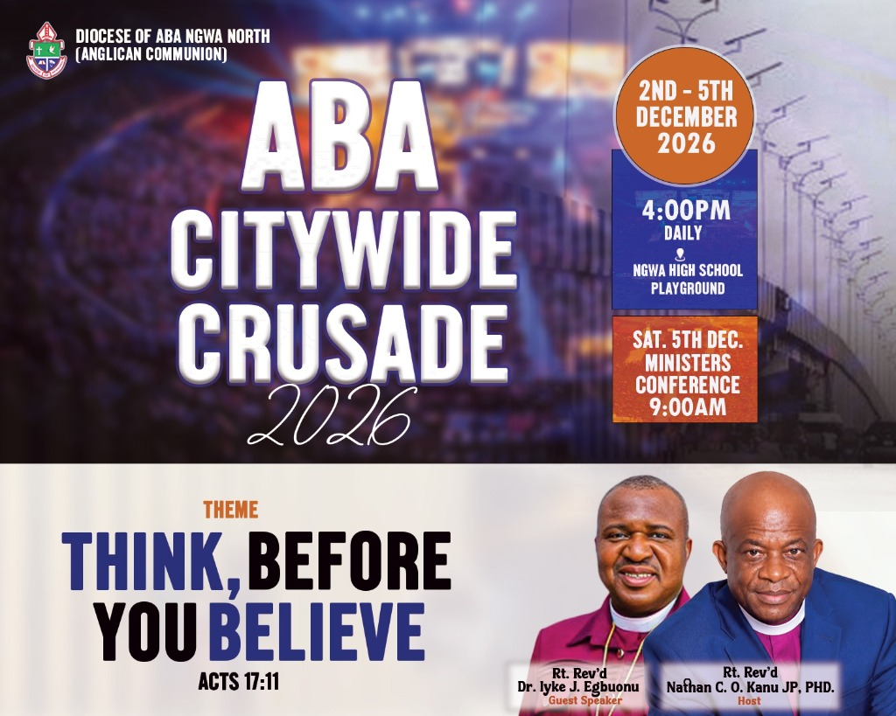

# Aba Citywide Crusade 2026 — Official Landing Page



A modern, high-performance, responsive single-page event landing page designed and built for the **ABA CITYWIDE CRUSADE 2026**, organized by the **Diocese of Aba Ngwa North (Anglican Communion)**.

---

## 📅 Event Information

| Detail | Information |
| :--- | :--- |
| **Event Name** | **ABA CITYWIDE CRUSADE 2026** |
| **Organizing Body** | **Diocese of Aba Ngwa North (Anglican Communion)** |
| **Theme** | **THINK BEFORE YOU BELIEVE** |
| **Bible Reference** | **Acts 17:11** |
| **Crusade Dates** | **2nd to 5th December 2026** |
| **Daily Crusade Time** | **4:00 PM Daily (WAT)** |
| **Venue** | **Ngwa High School Playground, Aba, Abia State** |
| **Guest Speaker** | **The Rt. Rev. Dr. Iyke J. Egbuonu** *(Bishop, Diocese of Oji River)* |
| **Host** | **The Rt. Rev. Nathan C. O. Kanu JP, PhD.** *(Bishop, Diocese of Aba Ngwa North)* |
| **Special Programme** | **Ministers Conference** |
| **Ministers Conf. Date** | **Saturday, 5th December 2026** |
| **Ministers Conf. Time** | **9:00 AM (WAT)** |
| **Official Registration** | [EventRally Registration Portal](https://www.geteventrally.com/events/bc7509fd-31fb-4ec1-881a-7e07f1a7ad8b) |

---

## 🎨 Visual Identity & Brand Palette

The design reflects an international Christian conference aesthetic featuring:
- **Deep Navy Blue:** `#040916`, `#06122c`, `#0c1e47`
- **Royal Blue:** `#1d4ed8`, `#2563eb`, `#1e40af`
- **Warm Orange:** `#f97316`, `#ea580c`, `#c2410c`
- **Subtle Gold Accents:** `#f59e0b`, `#fbbf24`, `#d97706`
- **Pure White & Slate:** Clean typography hierarchy using *Plus Jakarta Sans* and *Cinzel*

All visual assets preserve the authentic episcopal portraits and official diocese crest directly extracted from the original publicity flyer.

---

## 🚀 Key Features

1. **Sticky Glassmorphic Navigation Header:**
   - Official diocese crest branding
   - Smooth scroll jump links (`Home`, `About`, `Theme`, `Programme`, `Speakers`, `Venue`, `Register`)
   - Direct CTA buttons and mobile navigation drawer

2. **Hero Section:**
   - High-impact visual composition
   - Live real-time countdown timer to **December 2, 2026 at 4:00 PM WAT**
   - Theme and scripture badge
   - Dual Call-to-Actions (Register Now & Explore Event)

3. **About Section:**
   - Exposition of diocesan revival vision
   - Four core spiritual pillars (Biblical Truth, Awakening, Fellowship, Miracles)
   - Visual flyer artwork card

4. **Event Theme Deep Dive:**
   - Prominent typographic treatment of **"THINK BEFORE YOU BELIEVE"**
   - Theological exposition of Acts 17:11 Berean nobility in examining scriptures daily

5. **Programme Schedule:**
   - Interactive 4-day crusade itinerary cards (Daily 4:00 PM)
   - Distinctive spotlight card for the **Ministers Conference** (Saturday, 5th Dec @ 9:00 AM)

6. **Featured Ministers:**
   - High-definition portrait cards for **The Rt. Rev. Dr. Iyke J. Egbuonu** (Guest Speaker) and **The Rt. Rev. Nathan C. O. Kanu JP, PhD** (Host)
   - Episcopate badges and ministerial profiles

7. **Venue & Directions:**
   - Ngwa High School Playground, Aba
   - Embedded Google Maps location preview
   - 1-click **Get Directions** navigation button

8. **Attendance & Registration System:**
   - Direct routing to [official EventRally portal](https://www.geteventrally.com/events/bc7509fd-31fb-4ec1-881a-7e07f1a7ad8b)
   - Client-side validated quick RSVP form
   - Celebratory confetti on submission
   - 1-click WhatsApp invitation generator

9. **Interactive Flyer Modal:**
   - Full-resolution preview of official diocesan flyer with instant download option

10. **SEO & Social Sharing:**
    - Open Graph and Twitter Card tags
    - Dedicated 1200x630 social preview banner (`/og-image.jpg`)
    - Diocesan crest favicon (`/favicon.png`, `/favicon.ico`)

---

## 🛠️ Technologies Used

- **Framework:** React 18
- **Language:** TypeScript
- **Build Tool:** Vite 5
- **Styling:** Tailwind CSS 3 with PostCSS & Autoprefixer
- **Icons:** Lucide React
- **Celebration Effects:** Canvas Confetti

---

## 💻 Installation & Local Development

### Prerequisites
- Node.js (v18.0.0 or higher recommended)
- npm (v9.0.0 or higher)

### 1. Clone the repository
```bash
git clone <REPOSITORY_URL>
cd Crusade
```

### 2. Install dependencies
```bash
npm install
```

### 3. Run development server
```bash
npm run dev
```
The application will be available at `http://localhost:5173`.

### 4. Build for production
```bash
npm run build
```
The optimized production bundle will be generated in the `dist/` directory.

### 5. Preview production build locally
```bash
npm run preview
```

---

## 🚢 Deployment Instructions

### Deploy to Vercel
```bash
npm i -g vercel
vercel
```

### Deploy to Netlify
1. Drag and drop the `dist` folder onto [Netlify Drop](https://app.netlify.com/drop), or:
2. Connect your GitHub repository with build command `npm run build` and publish directory `dist`.

### Deploy to GitHub Pages
1. Install `gh-pages`:
   ```bash
   npm install --save-dev gh-pages
   ```
2. Add deploy script to `package.json`:
   ```json
   "deploy": "vite build && gh-pages -d dist"
   ```
3. Set base path in `vite.config.ts`: `base: '/<repo-name>/'`

---

## 🏛️ Copyright & Credits

Organized by the **Diocese of Aba Ngwa North (Anglican Communion)**  
Theme: *Think Before You Believe* (Acts 17:11)  
All rights reserved © 2026
